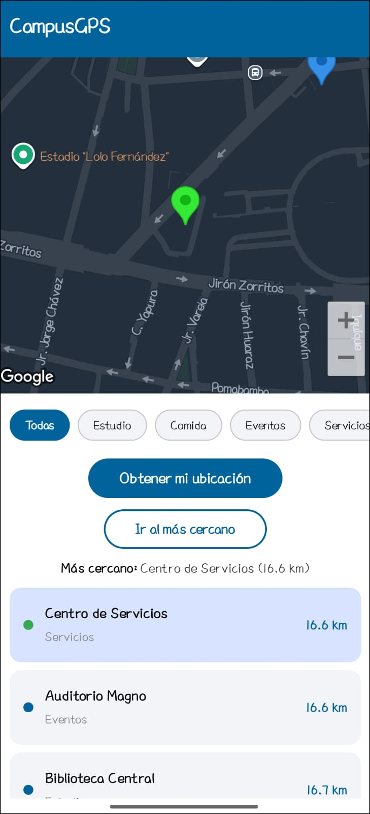

# Registro de Prompts de Mejoras con IA 

En este documento se registran los prompts principales utilizados para la implementación de las mejoras del proyecto **CampusGPS**, junto con el resumen de la respuesta generada por la IA, las adaptaciones realizadas y el criterio técnico aplicado.

---

## 📋 Registro de Prompts

| Prompt que escribí | Qué respondió Gemini | Qué cambié o descarté | Por qué |
| :--- | :--- | :--- | :--- |
| **Prompt 1:** `"Genera el código para implementar un filtro por categorías usando Chips (Estudio, Comida, Eventos, Servicios) en la app CampusGPS. Al seleccionar un chip, se deben mostrar solo esos lugares correspondientes tanto en el mapa como en la lista. Realiza los cambios modificando únicamente las capas ViewModel y View, asegurándote de no romper la arquitectura MVVM + Repository"` | Implementó el filtrado dinámico por categoría (`Estudio`, `Comida`, `Eventos`, `Servicios`) utilizando `FilterChip` de Material 3 en `PantallaMapa` y combinando flujos `StateFlow` en el `MapaViewModel`. Sugirió el título: `feat: agregar filtrado dinamico por categoria de lugares en mapa y lista`. | Se ajustaron las categorías locales en `LugaresRepositoryLocal` para incluir un lugar representativo de la categoría "Servicios". | Para mantener consistencia exacta entre las opciones de los chips visuales y los marcadores filtrados en el mapa sin alterar la estética de la app. |
| **Prompt 2:** `"Implementa la función 'Último lugar visitado' usando DataStore para guardar el último lugar seleccionado y recuperarlo al abrir la app. Modifica únicamente las capas Repository y ViewModel, manteniendo la arquitectura MVVM."` | Implementó la persistencia del último lugar seleccionado utilizando Jetpack DataStore Preferences. Creó la interfaz y repositorio `UserPreferencesRepository` para guardar/recuperar `ultimoLugarId` y lo vinculó al `MapaViewModel` y `PantallaMapa`. Sugirió el título: `feat: guardar y recuperar ultimo lugar visitado usando DataStore Preferences`. | Se ejecutó el sync de dependencias Gradle para DataStore y se delegó la lectura asíncrona a un `LaunchedEffect` en Compose. | Para evitar bloqueos del hilo principal de UI al leer preferencias locales y restaurar inmediatamente el enfoque de la cámara al abrir la app. |
| **Prompt 3:** `"Aplica el estilo oscuro al mapa mediante MapStyleOptions cuando el tema de la app sea oscuro. Modifica únicamente la capa View, manteniendo la arquitectura MVVM."` | Implementó el soporte de modo oscuro para Google Maps mediante `MapStyleOptions` aplicando un JSON de estilo nocturno cuando `isSystemInDarkTheme()` es verdadero. Sugirió el título: `feat(ui): aplicar MapStyleOptions para soporte de modo oscuro en Google Maps`. | Se memoizó la configuración mediante `remember(esTemaOscuro)` pasando el resultado al parámetro `properties = MapProperties(...)` de `GoogleMap`. | Para optimizar la memoria y evitar la reinstanciación innecesaria de las opciones de estilo del mapa durante ciclos repetidos de recomposición. |

---

## 🖼️ Evidencia de Mejoras Implementadas con IA

  
   
  <i>Captura de pantalla de la evidencia de las mejoras implementadas con IA.</i>

---

## 📝 Resumen Breve de Mejoras Implementadas

1. **Filtrar por categoría (Mejora 1)**: Selección interactiva por Chips para filtrar tanto los marcadores en el mapa como los elementos en la lista inferior.
2. **Último lugar visitado (Mejora 2)**: Almacenamiento persistente con Jetpack DataStore Preferences que recuerda la última selección del usuario al abrir la aplicación.
3. **Mapa en modo oscuro (Mejora 3)**: Personalización del mapa con `MapStyleOptions` para renderizado en modo nocturno cuando el tema oscuro del sistema está activo.
