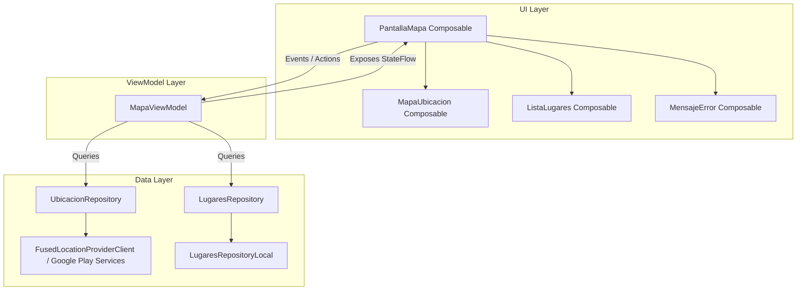
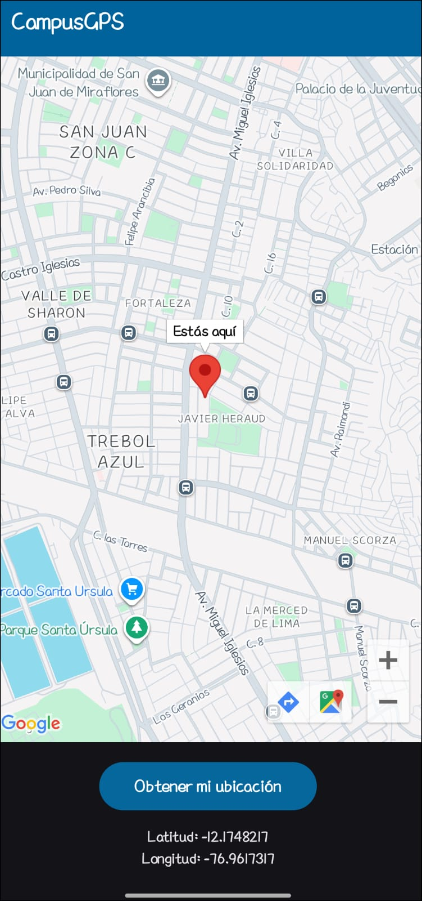
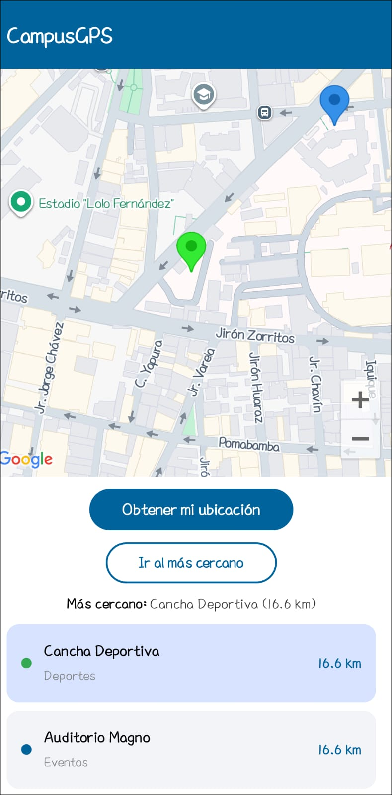
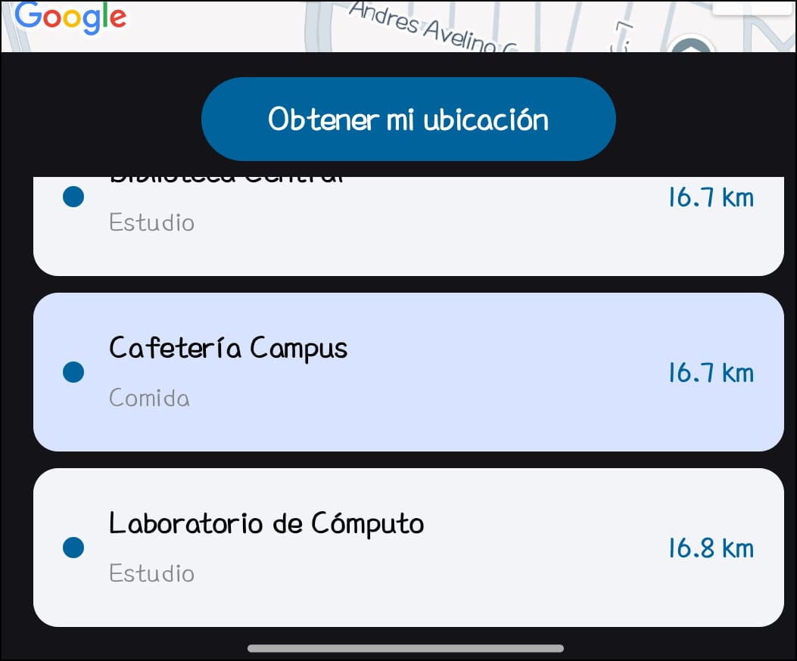
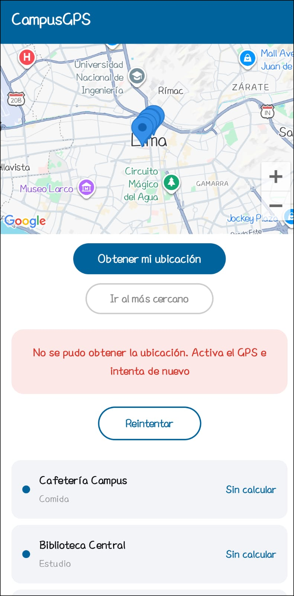
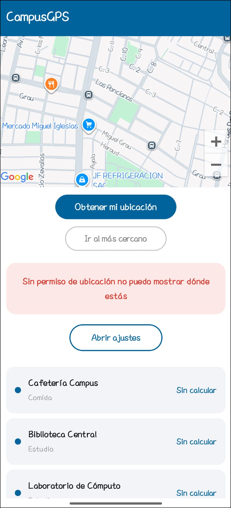

# CampusGPS 📍

Aplicación móvil desarrollada en **Android** con **Kotlin** y **Jetpack Compose** para la localización interactiva de puntos de interés en el campus universitario mediante integración con **Google Maps SDK** y **FusedLocationProviderClient**.

---

## 📝 Descripción

**CampusGPS** es una aplicación diseñada para ayudar a los estudiantes y visitantes a ubicarse dentro del campus universitario. Permite:
- Obtener la ubicación actual del usuario mediante GPS.
- Visualizar un mapa interactivo con Google Maps.
- Mostrar marcadores diferenciados por color: **Rojo** para la ubicación del usuario, **Verde** para el lugar más cercano y **Azul** para los demás puntos de interés del campus.
- Calcular y ordenar automáticamente los lugares según su cercanía en metros o kilómetros.
- Seleccionar cualquier lugar de la lista para enfocar la cámara del mapa directamente sobre él y desplegar su información.
- Gestionar de forma resiliente y amigable los errores de GPS apagado, permisos denegados o ausencia de Google Play Services sin que la aplicación se cierre.

---

## 📁 Árbol de Paquetes

```text
com.carbajal.campusgps
├── MainActivity.kt                      # Actividad principal de la aplicación
├── data
│   ├── LugaresRepository.kt             # Interfaz del repositorio de lugares
│   ├── LugaresRepositoryLocal.kt        # Implementación local con lugares del campus
│   ├── UbicacionRepository.kt           # Interfaz del repositorio de ubicación y Play Services
│   └── UbicacionRepositoryGoogle.kt     # Implementación con FusedLocationProviderClient
├── model
│   └── Modelos.kt                       # Data classes (Posicion, Lugar, LugarConDistancia) y TipoError
├── ui
│   ├── ListaLugares.kt                  # Composable LazyColumn para la lista ordenada de lugares
│   ├── MapaUbicacion.kt                 # Composable para la renderización de Google Maps y marcadores
│   ├── MensajeError.kt                  # Composable para notificar errores y acciones
│   ├── PantallaMapa.kt                  # Pantalla principal con Scaffold, mapas y controles
│   └── theme                            # Configuración del tema claro, colores y tipografía
│       ├── Color.kt
│       ├── Theme.kt
│       └── Type.kt
├── util
│   ├── Distancia.kt                     # Cálculo de distancia entre posiciones (Location.distanceBetween)
│   └── Formato.kt                       # Formateador de distancias en metros (m) y kilómetros (km)
└── viewmodel
    └── MapaViewModel.kt                 # ViewModel que gestiona el estado de UI (StateFlow)
```

---

## 📐 Diagrama de Arquitectura (MVVM)

La aplicación sigue el patrón de arquitectura **MVVM (Model-View-ViewModel)** recomendado por Google, garantizando la separación de responsabilidades y el flujo unidireccional de datos (UDF):



---

## 🖼️ Secciones y Capturas de Pantalla

<div align="center">

| **1. Solicitud y Permisos (`Paso 2`)** | **2. Ubicación y Lugar Más Cercano (`Paso 3 & 7`)** |
| :---: | :---: |
|  |  |
| *Pantalla inicial y diálogo nativo de permisos de Android.* | *Marcador de tu posición (Rojo) y lugar más cercano (Verde).* |

<br/>

| **3. Lista Ordenada por Distancia (`Paso 5 & 6`)** | **4. Error: Permiso Denegado (`Paso 8`)** |
| :---: | :---: |
|  |  |
| *Listado de lugares ordenado de menor a mayor cercanía.* | *Aviso claro y botón para acceder a Ajustes del sistema.* |

<br/>

| **5. Error: GPS Apagado (`Paso 8`)** |
| :---: |
|  |
| *Notificación para activar el GPS con botón de Reintentar.* |

</div>

---

## 💡 Para pensar (Preguntas y Respuestas)

### 1. ¿Por qué `FusedLocationProviderClient` está dentro del Repository y no en el ViewModel?
* **Respuesta:**
  - **Separación de Responsabilidades:** El `ViewModel` debe ocuparse de la lógica de presentación y mantener el estado de la interfaz de usuario (`StateFlow`), mientras que la capa de datos (**Repository**) se encarga de interactuar con las APIs físicas, sensores o servicios de Android.
  - **Desacoplamiento y Testabilidad:** Al aislar `FusedLocationProviderClient` dentro de `UbicacionRepository`, el `ViewModel` depende únicamente de una interfaz abstracta. Esto permite crear pruebas unitarias e inyectar un repositorio simulado (*Mock/Fake*) sin necesidad de ejecutar emuladores o servicios de Google Play Services.
  - **Prevención de fugas de memoria (Memory Leaks):** Evita mantener referencias a objetos de bajo nivel del SDK de Android o del `Context` dentro del `ViewModel`.

---

### 2. ¿Qué diferencia hay entre el permiso de ubicación y la clave de API de Maps? ¿Qué pasa si falta cada uno?
* **Respuesta:**
  - **Permiso de ubicación (`ACCESS_FINE_LOCATION` / `ACCESS_COARSE_LOCATION`):** Es una autorización runtime que otorga el **usuario final** para permitir que la aplicación acceda al GPS y sensor del dispositivo.
    - *Si falta o se niega:* La app no podrá consultar las coordenadas del usuario y mostrará el estado de error de permisos (`TipoError.SIN_PERMISO`).
  - **Clave de API de Maps (`MAPS_API_KEY`):** Es una credencial otorgada por **Google Cloud Platform** al **desarrollador** para hacer uso del SDK de mapas.
    - *Si falta o es inválida:* El mapa no se renderizará (la vista del mapa aparecerá vacía o en gris) y en Logcat se mostrará una excepción de autenticación de Google Maps.

---

### 3. ¿Por qué la clave va en `local.properties` y no en el código? ¿Qué harías si se subiera a GitHub por error?
* **Respuesta:**
  - **Por qué en `local.properties`:**
    - `local.properties` es un archivo local excluido del control de versiones (`.gitignore`). Al colocar allí la clave y vinculada mediante `manifestPlaceholders` en Gradle, evitamos exponer credenciales secretas en repositorios públicos.
  - **Qué hacer si se sube a GitHub por error:**
    1. **Revocar/Eliminar la clave:** Acceder a la consola de Google Cloud Console y eliminar la clave expuesta inmediatamente.
    2. **Generar una nueva clave:** Crear una clave de reemplazo aplicando restricciones de aplicación (SHA-1 fingerprint y paquete de la app `com.carbajal.campusgps`).
    3. **Limpiar el historial de Git:** Utilizar herramientas como `git filter-repo` o BFG Repo-Cleaner para purgar el commit del historial de Git, asegurando que la clave no permanezca accesible en ramas o commits antiguos.

---

### 4. ¿Dónde calculas la distancia y por qué no en el Composable?
* **Respuesta:**
  - **Dónde se calcula:** Se calcula en la capa de negocio/ViewModel (`MapaViewModel.actualizarDistancias()`) haciendo uso de la función utilitaria `distanciaMetros()`.
  - **Por qué NO en el Composable:**
    - **Rendimiento:** Los Composables pueden ejecutarse decenas de veces por segundo durante animaciones, scroll o recomposiciones. Hacer cálculos matemáticos de distancias o listas dentro del Composable degradaría el rendimiento de la UI (provocando *jank* o caídas de FPS).
    - **Flujo Unidireccional de Datos (UDF):** La vista (Composable) debe limitarse a renderizar los datos que recibe. Toda transformación de estado, cálculo numérico u ordenamiento debe realizarse previamente en el ViewModel.

---

### 5. ¿Qué pasa con tu app si el usuario niega el permiso dos veces? ¿Cómo lo manejas?
* **Respuesta:**
  - **Comportamiento del SO:** A partir de Android 11 (SDK 30), cuando el usuario niega un permiso dos veces, el sistema operativo asume un rechazo permanente y desactiva el diálogo nativo de solicitud. Llamadas posteriores a `lanzador.launch()` no mostrarán nada en pantalla.
  - **Manejo en la App:**
    - Detectamos el rechazo del permiso y emitimos el estado `TipoError.SIN_PERMISO`.
    - Presentamos un mensaje claro en pantalla acompañado del botón **"Abrir ajustes"**, el cual invoca un `Intent` hacia la configuración del sistema para la app (`Settings.ACTION_APPLICATION_DETAILS_SETTINGS` con `package:${contexto.packageName}`). Esto le permite al usuario habilitar el permiso manualmente sin que la app falle ni se cierre.
